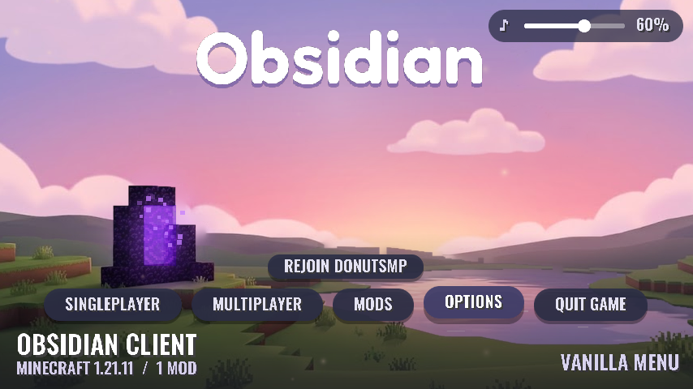

# Obsidian Client

A Fabric mod for Minecraft 1.21.11 that replaces the main menu with the Obsidian one.



## What it does

- **Intro.** The first time the menu opens each launch, the scene fades in from black,
  the "Obsidian" title rises in and the buttons follow. Click or press any key to skip it.
- **Title and text.** The title uses Fredoka (soft and rounded); buttons and labels use
  Oswald (condensed bold). Both are SIL Open Font License fonts, bundled in
  `assets/obsidian/font/` with their licences in `font-licenses/`.
- **Animated background.** A calm sunset over a lake with an obsidian portal
  (`tools/art/sunset.jpg`), split into sky, cloud and ground layers. The clouds drift,
  the portal plays the real nether portal animation and gives off purple particles, the
  lake sparkles, the sunset glow breathes and warm specks of light float about. Moving the
  mouse pans the layers gently side to side at different depths. See
  `screenshots/obsidian-menu.mp4`.
- **Same background everywhere.** Singleplayer, Multiplayer, Options and the other menus
  show the scene (blurred and darkened by Minecraft as usual) instead of the panorama.
- **Buttons.** A row of slim pill buttons along the bottom: Singleplayer, Multiplayer,
  Mods, Options, Quit Game. Once you have played on a server, a small "Rejoin <server>"
  pill appears above them. Every button has a hover tick and a click chime.
- **Menu music.** `menu_music.ogg` starts with the intro and loops for as long as you are
  in the menus. It fades out when you join a world and back in when you leave. Vanilla menu
  music is muted while it plays.
- **Mods.** Opens Mod Menu if you have it, otherwise a built-in list with an
  "Open Mods Folder" button.
- **Volume** (top right). Drag the slider, or click the ♪ to mute. It only changes the
  menu music, not your Minecraft volume.
- **Info** (bottom left). Client name, Minecraft version and how many mods are loaded.
- **Vanilla Menu** (bottom right). Switches to the normal Mojang title screen. A
  "◆ Obsidian" button in its top right corner switches back. The choice is remembered.
- **Movable panels.** Drag the logo, buttons, info or volume to move them. Right-click one
  to put it back. Positions are saved.
- **Smooth.** Vanilla caps menus at 60 FPS; the Obsidian menu runs at your normal Max
  Framerate setting, and everything moves with sub-pixel precision.
- **Loading screen.** Dark background and a violet progress bar instead of Mojang red.
  The Mojang logo stays because nothing from a mod can be drawn that early.

Settings are saved in `config/obsidian.json`.

## Install

1. Get the jar: GitHub Actions builds it on every push (workflow "Build Obsidian Client").
   It is also committed to `builds/`.
2. Put it in `.minecraft/mods` with Fabric Loader 0.17.3 or newer for 1.21.11. Fabric API is
   not required (the bits it needs are bundled), but it is fine if you have it.
   It works alongside Meteor and the Spawner Finder addon.

## Changing the music or logo

- Music: replace `src/main/resources/assets/obsidian/sounds/menu_music.ogg` with any
  `.ogg` file (`ffmpeg -i song.mp3 -c:a libvorbis -q:a 4 menu_music.ogg`).
- Fonts: replace `oswald.ttf` / `fredoka.ttf` in `assets/obsidian/font/` (and adjust
  `ui.json` / `title.json` if the new font sits too high or low).
- Glow, pill shape and mod icon: `python3 tools/make_sprites.py` (needs Pillow).
- Background: replace `tools/art/sunset.jpg` (and the cloud, portal and lake positions at
  the top of `tools/make_scene.py` if they moved), then run `python3 tools/make_scene.py`
  (needs Pillow, numpy and opencv-python-headless). It cuts out the clouds and ground,
  fills the gaps, and regenerates `SceneLayout.java`.
- Button sounds: `python3 tools/make_sounds.py` (needs numpy and ffmpeg), or drop your own
  `hover.ogg` and `click.ogg` into `src/main/resources/assets/obsidian/sounds/`.
- Fonts: replace `oswald.ttf` / `fredoka.ttf` in `assets/obsidian/font/` (and adjust
  `ui.json` / `title.json` if the new font sits too high or low).
- Glow, pill shape and mod icon: `python3 tools/make_sprites.py` (needs Pillow).
- Background: replace `tools/art/space.webp` and update the object boxes in
  `tools/make_space.py`, then run `python3 tools/make_space.py` (needs Pillow, numpy and
  opencv-python-headless). It cuts the listed objects into sprites, fills the holes, and
  regenerates `SpaceLayout.java`.
- Frame rate: launch with `-Dobsidian.logFps=true` to print it to the log every 3 seconds.

## Build

```sh
gradle build    # Gradle 9; jar ends up in build/libs/
```
